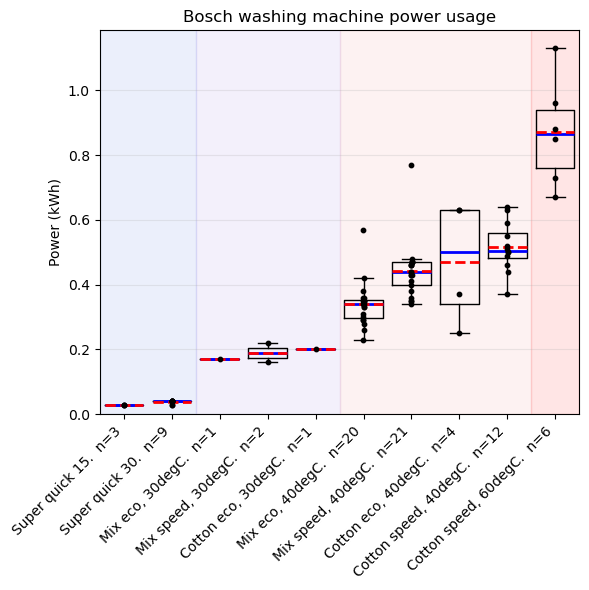

# Bosch washing machine power usage

## Washing machine

- 9kg capacity
- 1400rpm spin speed
- Serie 8
- E-Nr: WAW28420AU/24

## Results

## Conclusions

- Power usage clearly depends on temperature.  A useful rule of thumb is power usage is $0.02\times(T - 20)$ kWh.  Viz, very small for cold washes, 0.2kWh for 30degC, 0.4kWh for 40degC, and 0.8kWh for 60degC.  Probably, the cold-water temperature is about 20degC here in Australia.  Heating water is the dominant energy requirement.
- Within one cycle type and temperature, there is substantial variation.  Anecdotally, I suspect the variation depends on type and amount of clothes to be washed
- Mix speed at 40degC has a statistically higher power usage than Mix eco at 40degC.
  - Mix speed: mean = 0.441 kWh, SD = 0.088, n = 21
  - Mix eco:   mean = 0.340 kWh, SD = 0.070, n = 20
  - Difference in means (speed - eco) = 0.102 kWh
  - 95% CI for difference = [0.052, 0.152] kWh
  - Welch t-test: t = 4.130, df = 37.8, p = 0.0001932

