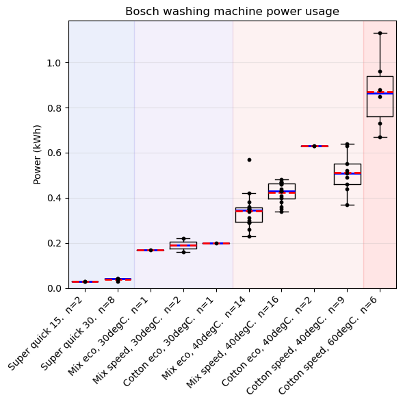

# Bosch washing machine power usage

## Washing machine

- 9kg capacity
- 1400rpm spin speed
- Serie 8
- E-Nr: WAW28420AU/24

## Results

## Conclusions

- Power usage clearly depends on temperature.  A useful rule of thumb is power usage is $0.02\time(T - 20)$kWh.  Viz, very small for cold washes, 0.2kWh for 30degC, 0.4kWh for 40degC, and 0.8kWh for 60degC.  Heating water is the dominant energy requirement.
- Within one cycle type and temperature, there is substantial variation.  Anecdotally, I suspect the variation depends on type and amount of clothes to be washed
- Mix speed at 40degC has a statistically higher power usage than Mix eco at 40degC.  The means and standard deviations are (0.424, 0.046)kWh and (0.343, 0.082)kWh, respectively.  Difference in means is 0.081kWh, 95% CI for difference is [0.029, 0.133]kWh, p value is 0.0039.

